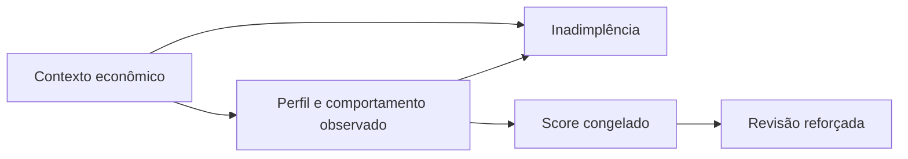

# Credit Monitoring Tech Challenge

Implementação local e reproduzível de um pipeline de risco de crédito com contratos de dados, simulação de drift, observabilidade e auditoria.

O planejamento detalhado está em [`docs/README.md`](docs/README.md). O estado das entregas está em [`docs/implementation-plan.md`](docs/implementation-plan.md).

## Requisitos

- Python 3.12
- [uv](https://docs.astral.sh/uv/)
- Make

## Ambiente

```bash
make setup
make check
```

`make check` executa lint, verificação de formatação e testes rápidos. Dados e artefatos de runtime permanecem fora do Git; somente evidências agregadas selecionadas são versionadas.

## Comandos

| Comando | Finalidade |
|---|---|
| `make setup` | Sincronizar o ambiente a partir do lockfile |
| `make lint` | Verificar lint e formatação |
| `make test` | Executar a suíte rápida |
| `make notebook-check` | Validar estaticamente o notebook Marimo |
| `make check` | Executar lint, testes e validação do notebook |
| `make demo` | Executar D4, preparar/treinar o baseline, monitorar E5 e auditar E6 |
| `make d4-demo` | Executar somente a fatia vertical D4 |
| `make prepare-data` | Baixar, verificar e particionar o dataset UCI |
| `make train-real` | Treinar e registrar o baseline com dados reais preparados |
| `make e4` | Executar preparação e treino da entrega E4 |
| `make e5` | Executar as três safras, maturar M3 e registrar drift no MLflow |
| `make e6` | Auditar fairness sobre M3 maturado e registrar evidência agregada |
| `make evidence` | Exportar relatório HTML e resumos agregados versionáveis |
| `make notebook` | Abrir a EDA de drift sintético no Marimo |
| `make notebook-real` | Abrir a EDA do dataset UCI no Marimo |
| `make notebook-drift` | Abrir a investigação das safras E5 no Marimo |
| `make notebook-fairness` | Abrir a auditoria agregada E6 no Marimo |
| `make mlflow-ui` | Abrir o MLflow local em `http://127.0.0.1:5000` |

## Demonstração completa

```bash
make demo
make mlflow-ui
```

A demonstração bloqueia o lote D4 inválido antes da inferência, prepara os dados
UCI, treina o baseline, executa as safras E5 e audita fairness em E6. Use
`make d4-demo` para repetir somente a fatia vertical sintética. Artefatos e runs
ficam no store local sob `artifacts/runtime/`; logs e MLflow recebem somente
evidências agregadas, sem linhas de clientes.

## Dados reais e baseline

```bash
make e4
make notebook-real
make mlflow-ui
```

O projeto usa o dataset [Default of Credit Card Clients](https://doi.org/10.24432/C55S3H),
criado por I-Cheng Yeh e distribuído pela UCI sob licença CC BY 4.0. O download
é aceito somente com o SHA-256
`56c885f84457f6680f8438f02bfcdac9579323d8a94465ee5f26e32baa727602`.

A EDA fechou partições estratificadas de 60% para treino, 15% para validação,
15% para teste/referência e 10% para simulação. O modelo real atual é a
`Pipeline` logística de fallback, versão `real-logistic-v1`; não há WOE, escala
de pontos nem tabela de scorecard ativa. O limiar `review_required` é escolhido
por F2 somente na validação e congelado antes da avaliação no teste.

Resultados verificados no teste/referência:

| Métrica | Valor |
|---|---:|
| ROC-AUC | 0,7235 |
| Average Precision | 0,5142 |
| KS de discriminação | 0,3912 |
| Brier score | 0,1428 |
| Recall no limiar F2 | 0,5974 |

Fonte, perfil, tratamentos e manifesto das partições estão documentados em
[`docs/data-source.md`](docs/data-source.md).

## Safras e drift

```bash
make e5
make notebook-drift
make mlflow-ui
```

A E5 usa 2.250 registros do pool pós-congelamento para criar M1, M2 e M3 com
750 IDs disjuntos por mês. M1 e M3 são reservados aleatoriamente primeiro. M2
altera somente a seleção do restante: uma corrida exponencial ponderada aumenta a
participação de baixo limite, atraso e utilização, sem editar valores individuais.

No scoring, o Evidently e o PSI usam o teste como referência. M2 termina em
`PROCESSED_WITH_ALERTS`, com as sete features sinalizadas pelo Evidently, quatro
PSI acima de 0,10 e PSI do score igual a 0,2573. M1 e M3 têm somente PSI
informativo e terminam em `PROCESSED`.

Após a maturação de M3, o feed separado é associado um-para-um aos scores. O
simulador compara `p0(X)` com
`p1(X) = sigmoid(logit(p0(X)) + 2 * g(X))` usando o mesmo sorteio para `Y0` e
`Y1`. A probabilidade média sobe de 0,2163 para 0,2727, 55 desfechos pareados
mudam e o Brier do modelo congelado piora de 0,1594 para 0,1904. O intervalo
bootstrap da diferença, `[0,0212; 0,0415]`, aciona o alerta de desempenho.

O contraste demonstra apenas o mecanismo programado no simulador; não estima um
efeito causal econômico real. Relatórios completos e logs ficam em
`artifacts/runtime/drift-e5/`. A evidência selecionada está em
[`artifacts/evidence/e5-drift-summary.json`](artifacts/evidence/e5-drift-summary.json)
e no
[`relatório HTML de drift e observabilidade`](artifacts/evidence/drift-observability-report.html).

Este é um cenário de aceite determinístico, com semente e intensidade escolhidas
para exercitar os alertas. Ele não estima sensibilidade, taxa de falso alarme ou
desempenho futuro do detector. Os limiares PSI são convenções operacionais e o
Evidently pode sinalizar features isoladas mesmo nas safras tratadas como estáveis.

## Fairness e governança

```bash
make e6
make notebook-fairness
make mlflow-ui
```

A E6 reconstrói deterministicamente as 750 previsões e os desfechos maturados de M3. A visão restrita
mantida apenas em memória contém `ID`, grupo de sexo, faixa etária consolidada,
score, decisão e alvo. Sexo, idade e identificador continuam fora de
`MODEL_FEATURE_COLUMNS`; nenhum registro individual é persistido no MLflow.

Todos os grupos publicados cumprem o mínimo de 200 observações, 30 eventos e 30
não eventos. A diferença de equalized odds foi 0,0458 por sexo, IC bootstrap
`[0,0092; 0,1556]`, e 0,1344 por faixa etária, IC
`[0,0662; 0,2766]`. Como os limites inferiores permanecem abaixo do gatilho
operacional de 0,10, o estado é `MONITORING_CONTINUES`: coletar desfechos reais e
manter monitoramento, sem mitigação, retreino ou limiar específico por grupo.

O resumo agregado da última demo verificada está em
[`artifacts/evidence/e6-fairness-summary.json`](artifacts/evidence/e6-fairness-summary.json).

## Observabilidade

O MLflow centraliza versão do modelo, hashes de dados/modelo/código, parâmetros,
status, duração, volume, CPUs disponíveis, pico RSS do processo, alertas, logs JSON e relatórios completos. A demo registra
sucesso ou falha sanitizada de ingestão e transformação, o bloqueio do lote inválido no pipeline real, os estados mensais, a avaliação antes
e depois da maturação e o resultado agregado de fairness. O relatório HTML
versionado resume esses sinais sem copiar o banco local ou dados de clientes:

- [`drift-observability-report.html`](artifacts/evidence/drift-observability-report.html);
- [`monitoring-summary.json`](artifacts/evidence/monitoring-summary.json).

## Governança e LGPD

Este projeto acadêmico usa dados públicos e não concede nem nega crédito real. No
cenário hipotético, a fintech é a controladora e a base legal assumida para o
monitoramento de risco da carteira é proteção do crédito, art. 7º, X da LGPD. Essa
hipótese precisa de validação jurídica antes de produção.

- `ID`, sexo, idade, educação e estado civil não entram no modelo; sexo e faixas
  etárias aparecem apenas na visão restrita de auditoria.
- Dados e artefatos individuais ficam fora do Git, logs e MLflow; evidências de
  entrega contêm somente agregados com supressão para grupos sem suporte.
- A saída solicita revisão reforçada, não negativa automática. Não há retreino,
  promoção ou limiar por grupo automáticos.
- Retenção proposta: quarentena por até 30 dias; associação score-desfecho e visão
  restrita por 13 meses; métricas, contratos e validações durante a vida do modelo
  mais cinco anos. Depois do prazo, excluir ou anonimizar com evidência verificável.
- Produção exigiria criptografia, RBAC, pseudonimização, registro imutável de acesso,
  avaliação de impacto, contestação/revisão humana e processo para direitos do art. 18.

O plano completo e suas limitações estão em
[`docs/governance-plan.md`](docs/governance-plan.md) e
[`docs/fairness-plan.md`](docs/fairness-plan.md).

## Causalidade e limites



Em M3, o projeto intervém somente no mecanismo sintético de desfecho, preservando
as mesmas entradas, scores e sorteios pareados para comparar `p0(X)` e `p1(X)`.
Isso comprova o mecanismo programado, não identifica efeito de inflação,
desemprego ou política de crédito no mundo real. O dataset é transversal, de
Taiwan em 2005, contém apenas clientes já aprovados e pode carregar proxies de
políticas históricas. O DAG e as hipóteses completas estão em
[`docs/causal-model.md`](docs/causal-model.md).

Os rótulos de fairness também são sintéticos e não incluem um efeito demográfico
explícito. A análise não cobre interseccionalidade, candidatos rejeitados ou todos
os proxies possíveis; portanto não demonstra ausência de viés.

## Vídeo STAR

O roteiro cronometrado está em [`docs/video-star-plan.md`](docs/video-star-plan.md).
O link do vídeo de até cinco minutos deve ser incluído aqui após a gravação; esta é
a única etapa obrigatória que não pode ser produzida automaticamente pelo pipeline.
