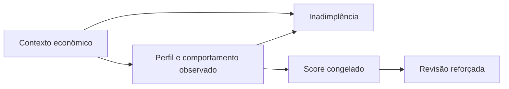

# Monitoramento contínuo de risco de crédito

**Tech Challenge — Fase 4 | Guia para execução e avaliação**

Uma fintech usa um modelo para priorizar propostas de crédito para revisão. Mesmo que o código do modelo não mude, o perfil dos clientes pode mudar e os resultados reais podem demorar a chegar. Dados inválidos, mudanças na população ou uma relação diferente entre comportamento e inadimplência podem, assim, comprometer o uso do modelo sem uma falha técnica aparente.

Este projeto constrói uma demonstração local desse problema: valida os dados antes do scoring, acompanha três safras simuladas, compara distribuições e desempenho, registra a execução no MLflow e analisa riscos de privacidade e de disparidade entre grupos. A saída do modelo indica **revisão reforçada**, não aprovação ou negativa automática de crédito.

> **Vídeo STAR: pendente de gravação e publicação.** O roteiro está em [`docs/video-star-plan.md`](docs/video-star-plan.md); o link do vídeo ainda precisa ser adicionado antes da entrega. O vídeo corresponde a 15% da avaliação.

## Comece por aqui: roteiro do avaliador

| Ordem | Critério do enunciado | Peso | Onde verificar |
|---|---|---:|---|
| 1 | Validação de dados | 25% | [Contrato e lote rejeitado](#1-validação-de-dados--25) |
| 2 | Detecção de drift | 25% | [Safras, Evidently e desempenho](#2-detecção-de-drift--25) |
| 3 | Observabilidade e logs | 20% | [Relatório e MLflow](#3-observabilidade-e-logs--20) |
| 4 | Governança e LGPD | 15% | [Privacidade, fairness e causalidade](#4-governança-privacidade-e-causalidade--15) |
| 5 | Vídeo STAR | 15% | [Estado do vídeo](#5-vídeo-star--15) |

Para uma inspeção rápida antes de executar o projeto, consulte o [relatório HTML agregado](artifacts/evidence/drift-observability-report.html) e o [resumo completo em JSON](artifacts/evidence/monitoring-summary.json). O HTML deve ser aberto em um navegador após clonar ou baixar o repositório; a visualização do GitHub pode mostrar apenas o código-fonte do arquivo.

## Clonar e executar

### Pré-requisitos

- Git, Python **3.12**, [uv](https://docs.astral.sh/uv/getting-started/installation/) e GNU Make.
- Ambiente Linux ou compatível com os comandos do Makefile; a demonstração foi validada em Linux.
- Acesso à internet na primeira execução para instalar dependências e baixar o dataset oficial da UCI. O download é verificado por SHA-256.
- Navegador para visualizar os relatórios e o MLflow local. Não são necessárias credenciais de serviços externos.

```bash
git clone https://github.com/FernandoFailla/techchallenge-fase4.git
cd techchallenge-fase4
make setup
make check
make demo
```

`make setup` instala as dependências com o lockfile; `make check` verifica lint, formatação, testes e os quatro notebooks; `make demo` executa a demonstração completa e atualiza as evidências agregadas. Aguarde o término de cada comando antes de passar ao próximo.

Para examinar a interface de rastreamento, em um terminal separado execute:

```bash
make mlflow-ui
```

Abra **<http://127.0.0.1:5000>**. Interrompa o servidor com `Ctrl+C` quando terminar. O projeto gera dados em `data/` e runs e relatórios detalhados em `artifacts/runtime/`, diretórios locais ignorados pelo Git. As saídas selecionadas em `artifacts/evidence/` são versionadas e **serão alteradas** por `make demo`; IDs de runs, tempos e uso de memória variam entre execuções. A execução a partir de uma árvore modificada também registra esse estado na proveniência.

### O que acontece na demonstração

1. Uma fatia sintética D4 pontua um lote válido e rejeita um lote corrompido.
2. O dataset UCI é baixado, validado e particionado; uma regressão logística é treinada e avaliada.
3. Um modelo congelado pontua três safras simuladas. M2 exercita o alerta de Data Drift; M3 recebe desfechos sintéticos após a data de maturação para avaliar Concept Drift.
4. A auditoria de fairness compara taxas de erro de grupos com suporte suficiente; o pipeline exporta resumos agregados e um relatório HTML.

## Antes dos critérios: dados e modelo

O dataset público [Default of Credit Card Clients](https://doi.org/10.24432/C55S3H), de I-Cheng Yeh, contém 30.000 registros e um alvo binário de inadimplência. A fonte UCI é distribuída sob licença CC BY 4.0. O checksum do arquivo oficial, a descrição das variáveis e as decisões de tratamento estão em [`docs/data-source.md`](docs/data-source.md).

| Partição estratificada | Registros | Papel |
|---|---:|---|
| Treino | 18.001 | Ajustar a regressão logística e orientar a EDA supervisionada |
| Validação | 4.499 | Escolher o limiar de revisão pela métrica F2 |
| Teste/referência | 4.501 | Avaliar o modelo congelado e servir de referência ao monitoramento |
| Pool de simulação | 2.999 | Formar as safras posteriores ao congelamento |

As partições são disjuntas; o treinamento verifica IDs duplicados e sobreposição. A EDA usa dados completos para verificações de estrutura e qualidade sem alvo, mas restringe relações com o alvo e decisões de tratamento ao treino. O modelo `real-logistic-v1` usa `StandardScaler` e regressão logística do Scikit-Learn. Não há WOE ou scorecard de pontos ativo.

**Para conferir:** em [`monitoring-summary.json`](artifacts/evidence/monitoring-summary.json), procure `training.model` e `training.metrics.test`. Na execução de referência, o teste apresenta ROC-AUC **0,7235**, Brier **0,1428** e recall **0,5974**. As features utilizadas, o limiar e o hash do modelo também estão no resumo. Para percorrer a EDA, após a demo execute `make notebook-real`.

## 1. Validação de dados — 25%

**Pergunta:** o modelo recebe dados inválidos ou o contrato interrompe o processamento antes da inferência?

Os schemas Pandera estão em [`src/credit_monitoring/contracts.py`](src/credit_monitoring/contracts.py). Entre as regras do contrato de scoring real estão:

- `ID` obrigatório e único; campos obrigatórios sem nulos e com tipos e ordem esperados;
- `LIMIT_BAL` maior que zero;
- `PAY_0` entre −2 e 8;
- `UTILIZATION_CURRENT` entre −1 e 2; a razão pagamento/fatura entre 0 e 5.

O alvo não integra o contrato de scoring. O feed de desfechos tem contrato separado e deve ser associado aos scores de forma um-para-um.

**Verificação guiada**

1. Abra o [relatório de drift e observabilidade](artifacts/evidence/drift-observability-report.html) no navegador e localize **Contrato de dados no pipeline real**.
2. Confirme `REJECTED`, **zero linhas pontuadas** e violações de `LIMIT_BAL`, `PAY_0` e `UTILIZATION_CURRENT`.
3. Em [`monitoring-summary.json`](artifacts/evidence/monitoring-summary.json), procure `training.invalid_batch`. A seção `d4` mostra uma segunda demonstração sintética, com um lote válido e outro rejeitado.
4. Para examinar a implementação e os testes, abra [`scripts/train_real_model.py`](scripts/train_real_model.py), [`tests/test_training.py`](tests/test_training.py) e [`tests/`](tests/).

## 2. Detecção de drift — 25%

**Pergunta:** a população que chega ao modelo mudou e, depois da maturação do desfecho, o desempenho também apresentou degradação?

### M1 e M2: mudança de distribuição antes do desfecho

Cada safra tem 750 registros disjuntos do pool de simulação. M1 e M3 são selecionadas aleatoriamente; M2 é selecionada com maior peso para perfis de menor limite, maior atraso e utilização, alterando a **composição** da amostra em múltiplas variáveis importantes sem editar os valores individuais. O mesmo modelo congelado gera os scores.

O Evidently compara cada safra com o teste/referência. O projeto calcula também o PSI com bins fixados na referência. Na execução de referência:

| Safra | Resultado agregado | Evidência |
|---|---|---|
| M1 | `PROCESSED` | PSI do score 0,0143 |
| M2 | `PROCESSED_WITH_ALERTS` | 7 features sinalizadas pelo Evidently; 4 features com PSI acima de 0,10; PSI do score 0,2573 |
| M3 | `PROCESSED` no scoring | PSI do score 0,0156; desfecho ainda não disponível |

M1 e M3 têm cada uma uma feature sinalizada individualmente pelo Evidently, mas não atingem o gatilho agregado do projeto. Na M2, as quatro features acima de 0,10 incluem um PSI em nível relevante e três em nível de warning. PSI é calculado pelo projeto; o KS de discriminação mostrado nas métricas do modelo é uma medida diferente.

**Verificação guiada**

1. No [relatório HTML](artifacts/evidence/drift-observability-report.html), veja **Data Drift e saúde mensal**.
2. Abra [`e5-drift-summary.json`](artifacts/evidence/e5-drift-summary.json) e procure `months.M2.evidently_drifted_features` e `psi_feature_warning_count` para identificar as variáveis e os alertas.
3. Após `make demo`, execute `make notebook-drift` para acompanhar a seleção, os scores e as comparações. Os relatórios Evidently completos ficam em `artifacts/runtime/drift-e5/<run_id>/`, incluindo `m2-data-drift.html`; o ID atual está em `artifacts/runtime/drift-e5/latest-run-id.txt`.

### M3: desfecho atrasado e Concept Drift sintético

O scoring ocorre em 1º de março de 2026 e o desfecho simulado fica disponível em 1º de abril: antes disso, o estado é `EVALUATION_BLOCKED`; depois, `MATURED`. Para as mesmas entradas `X` e o mesmo sorteio, o simulador compara o mecanismo inicial `p0(X)` com um mecanismo alterado `p1(X) = sigmoid(logit(p0(X)) + 2 * g(X))`.

Na execução de referência, a probabilidade média passa de **0,2163 para 0,2727** e 55 desfechos pareados mudam. O Brier do modelo congelado passa de **0,1594 para 0,1904**; a diferença é **0,0309**, com IC bootstrap de 95% **[0,0212; 0,0415]**, acionando alerta de desempenho. Confira `outcome_timeline`, `concept_drift` e `brier_shift` em [`e5-drift-summary.json`](artifacts/evidence/e5-drift-summary.json).

O cenário usa semente e intensidade escolhidas para exercitar os alertas: demonstra uma mudança de `P(X)` e de `P(Y|X)` **programada**, não estima desempenho futuro nem degradação econômica observada.

## 3. Observabilidade e logs — 20%

**Pergunta:** é possível acompanhar o ciclo de vida do pipeline, identificar falhas e chegar às evidências de drift?

Depois de `make demo`, execute `make mlflow-ui` e abra <http://127.0.0.1:5000>. Na lista de experimentos, examine a run mais recente de cada um:

| Experimento MLflow | O que procurar |
|---|---|
| `credit-data-preparation-e4` | Estado `PREPARED`, volume e artefato `data-preparation-e4/events.jsonl` com download, ingestão, transformação e persistência |
| `credit-monitoring-d4` | Estado do lote válido, lote inválido `REJECTED`, volume e alerta de drift |
| `credit-training-e4` | Versão do modelo, métricas de validação/teste e evidência do lote inválido |
| `credit-drift-e5` | Estados M1/M2/M3, métricas de drift e desempenho, eventos e relatórios Evidently |
| `credit-fairness-e6` | Estado de fairness, suporte dos grupos, métricas e playbook agregados |

Abra uma run para consultar **Parameters**, **Metrics**, **Tags** e **Artifacts**. O status técnico `FINISHED` significa que a execução concluiu; a tag `PROCESSED_WITH_ALERTS` indica alerta de negócio/monitoramento e não uma falha técnica. Os logs de preparação registram sucesso ou falha sanitizada por etapa. Duração, volume, contagens de falhas e alertas, CPUs disponíveis e pico de memória do processo oferecem sinais locais de saúde; não constituem monitoramento contínuo de uma infraestrutura de produção.

O [relatório HTML agregado](artifacts/evidence/drift-observability-report.html) oferece uma visão sem servidor. O [resumo de preparação](artifacts/evidence/data-preparation-summary.json) e o [resumo consolidado](artifacts/evidence/monitoring-summary.json) contêm os estados e a proveniência exportados. As evidências versionadas foram geradas a partir de código com revisão e hash registrados; ao executar a demo, novos IDs e informações de proveniência são gerados para seu ambiente.

## 4. Governança, privacidade e causalidade — 15%

### Finalidade, tratamento e base legal

Este é um projeto acadêmico com dataset público; nenhuma decisão real de crédito é tomada. No cenário hipotético, a fintech seria controladora e a hipótese de base legal para monitoramento de risco da carteira é **proteção do crédito, art. 7º, X, da LGPD**. Sua aplicação à finalidade concreta, inclusive a uma eventual decisão de crédito, exige validação jurídica; este projeto não certifica conformidade legal.

O `ID` é usado para associação de registros e não é feature do modelo. Sexo, idade, educação e estado civil também ficam fora das features de scoring; sexo e faixas de idade são usados em uma visão de auditoria restrita, mantida em memória. Dados locais, scores e desfechos individuais não são versionados nem enviados aos logs e artefatos MLflow da demonstração. As evidências de entrega são agregadas; grupos sem suporte suficiente têm métricas suprimidas.

### Retenção e controles

Para uma implantação hipotética, propõe-se: quarentena por até **30 dias**; associação score–desfecho e visão restrita por **13 meses**; métricas, contratos e validações durante a vida do modelo mais **cinco anos**. Findo o prazo, excluir ou anonimizar com evidência verificável. São prazos propostos, não uma política automatizada implementada neste repositório.

Uma implantação real ainda exigiria validação jurídica, criptografia, controle de acesso por papel, pseudonimização, trilha imutável de acesso, avaliação de impacto, revisão humana e procedimentos para os direitos dos titulares previstos no art. 18. O plano e as responsabilidades estão em [`docs/governance-plan.md`](docs/governance-plan.md).

### Vieses e resposta de governança

A auditoria Fairlearn de M3 compara grupos de sexo e faixas etárias fixas `21-29`, `30-39` e `40+`. Publica métricas de erro somente para grupos com pelo menos **200 registros, 30 eventos e 30 não eventos**. O limiar de decisão é comum aos grupos e os atributos demográficos não entram no modelo.

| Comparação | Diferença de equalized odds | IC bootstrap 95% |
|---|---:|---:|
| Sexo | 0,0458 | [0,0092; 0,1556] |
| Faixa etária | 0,1344 | [0,0662; 0,2766] |

O ponto estimado para idade supera 0,10, mas o limite inferior do intervalo não supera o gatilho operacional de 0,10. O estado é `MONITORING_CONTINUES`: manter o monitoramento e buscar desfechos temporais reais antes de mudanças de política. Não há mitigação, retreino, promoção ou limiar por grupo automáticos. Se não houver suporte, a comparação é bloqueada; um alerta sustentado exige investigação humana.

**Para conferir:** veja [`e6-fairness-summary.json`](artifacts/evidence/e6-fairness-summary.json), sobretudo `analyses` e `playbook`; execute `make notebook-fairness` após a demo para percorrer a auditoria. Detalhes e limitações estão em [`docs/fairness-plan.md`](docs/fairness-plan.md). Os rótulos são sintéticos, não incluem efeito demográfico explícito e a análise não cobre todos os proxies nem interseccionalidade; o resultado não demonstra ausência de viés.

### Causalidade e limites da demonstração



O DAG representa hipóteses, não relações identificadas pelos dados. Em M3, a intervenção é feita no mecanismo **sintético** do desfecho, mantendo entradas, scores e sorteios pareados para comparar `p0(X)` e `p1(X)`. Isso mostra o funcionamento do experimento, mas não identifica efeito causal de inflação, desemprego ou política de crédito no mundo real. O dataset é transversal, de Taiwan em 2005, e contém clientes já aprovados; sua representatividade é limitada. Veja [`docs/causal-model.md`](docs/causal-model.md).

## 5. Vídeo STAR — 15%

**Pendente:** gravar um vídeo de até cinco minutos e inserir aqui seu link público ou acessível ao avaliador. O [roteiro STAR](docs/video-star-plan.md) organiza situação, tarefa, ações e resultados; o [checklist da demonstração](docs/final-demo-checklist.md) ajuda a preparar as telas e a conferir os limites de privacidade.

## Comandos e arquivos para aprofundar

| Comando | Resultado |
|---|---|
| `make check` | Lint, formatação, testes e verificação estática dos quatro notebooks |
| `make demo` | Demonstração completa e atualização das evidências |
| `make d4-demo` | Apenas a demonstração sintética D4 |
| `make e4` | Preparação dos dados e treino do modelo real |
| `make e5` | Preparação, treino e monitoramento das três safras |
| `make e6` | Preparação, treino e auditoria de fairness M3 |
| `make evidence` | Reexportação das evidências a partir das runs locais existentes |
| `make notebook`, `make notebook-real`, `make notebook-drift`, `make notebook-fairness` | Abrir os notebooks Marimo correspondentes |
| `make mlflow-ui` | Iniciar o servidor MLflow local na porta 5000 |

O mapa completo entre exigências e evidências está em [`docs/requirements-traceability.md`](docs/requirements-traceability.md); a arquitetura e os demais documentos estão em [`docs/README.md`](docs/README.md). O [enunciado oficial](techchallenge/MLET%20-%20Tech%20Challenge%20-%20Fase%204-1.pdf) contém os critérios e pesos da avaliação.
