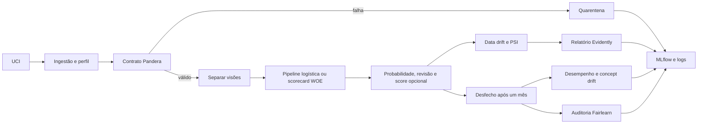
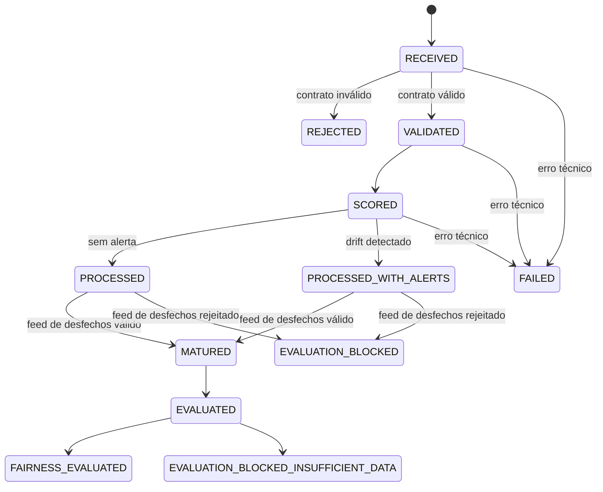

# Arquitetura implementada

## Princípios

- Um processo Python local, dividido por responsabilidades, sem microserviços.
- Artefatos e decisões reproduzíveis por semente, configuração e versão.
- Exploração em Marimo; persistência somente por scripts determinísticos.
- Manipulação Polars-first e conversão somente na fronteira de bibliotecas incompatíveis.
- Contrato antes do scorecard.
- Monitoramento sem rótulo separado da avaliação após maturação.
- Dados individuais fora de logs, Git e relatórios de entrega.

## Fluxo



## Capacidades

### Dados e qualidade

Baixa e normaliza os nomes das colunas com Polars, cria partições reproduzíveis, aplica os contratos Pandera e produz as visões de scoring e auditoria.

### Modelagem

O caminho preferencial ajusta bins, WOE e regressão somente no treino por interfaces Scikit-Learn; o fallback mantém uma Pipeline logística simples. A conversão de Polars ocorre uma vez na fronteira do estimador. Ambos exportam probabilidade, limiar, baseline e versão; pontos e tabela existem somente com o scorecard ativo.

### Simulação

Cria lotes mensais, altera a composição populacional e aplica a intervenção sintética nos desfechos. Todas as regras e sementes permanecem explícitas.

### Monitoramento e auditoria

Gera relatórios Evidently, gráficos Plotnine com tema do projeto, métricas de desempenho, alertas, métricas Fairlearn, logs estruturados e runs no MLflow.

### Orquestração local

Coordena os estados do lote e os comandos expostos pelo Makefile. Não contém lógica estatística própria.

## Ciclo de vida do lote



## Estrutura principal

```text
.
├── Makefile
├── pyproject.toml
├── uv.lock
├── README.md
├── configs/
├── notebooks/
├── src/credit_monitoring/
│   ├── data.py
│   ├── config.py
│   ├── contracts.py
│   ├── training.py
│   ├── scoring.py
│   ├── outcomes.py
│   ├── simulation.py
│   ├── monitoring.py
│   ├── fairness.py
│   └── __init__.py
├── scripts/
│   ├── prepare_data.py
│   ├── train_real_model.py
│   ├── run_d4_demo.py
│   ├── run_e5_drift.py
│   └── run_e6_fairness.py
├── tests/
├── docs/
├── data/                    # gerado e ignorado
├── artifacts/runtime/       # gerado e ignorado
└── artifacts/evidence/      # somente agregados selecionados entram no Git
```

A estrutura mostra as responsabilidades centrais; o repositório contém também módulos auxiliares de dados, treinamento, contratos e observabilidade. Notebooks não gravam artefatos; scripts chamam `src/`, enquanto carregamento e validação estrita do YAML permanecem em código testado de `src/`. Scripts controlam persistência e MLflow.
