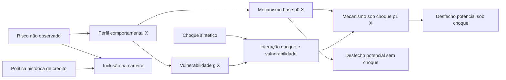

# Modelo causal da simulação

## Hipótese

O mecanismo implementado é deliberadamente menor que uma economia real. Um choque sintético aumenta a probabilidade de inadimplência, com efeito maior para perfis que já apresentam alta utilização e atraso. A simulação não afirma que o choque alterou pagamentos ou atrasos observados. A carteira também depende de uma política histórica de crédito, portanto não representa toda a população elegível.

## Como a simulação usa o DAG

- Mês 1 representa a distribuição saudável.
- Mês 2 altera o mecanismo de seleção da população, aumentando a presença de perfis sob estresse. Essa etapa demonstra mudança de `P(X)`, não um efeito causal estimado.
- No mês 3, `p0(X)` é o `predict_proba` congelado do próprio modelo monitorado e `p1(X) = sigmoid(logit(p0(X)) + delta * g(X))`, em que `g(X)` aumenta com utilização e atraso.
- Para cada linha, um mesmo sorteio `u ~ Uniform(0, 1)` gera `Y0 = 1[u < p0(X)]` e `Y1 = 1[u < p1(X)]`. O pareamento isola o contraste programado pelo simulador.
- O feed maturado usa `Y1`; `Y0`, `p0` e `p1` são evidências da simulação e não rótulos observados no mundo real.

## Limites de interpretação

O contraste do mês 3 recupera somente o efeito programado no simulador porque a intervenção e os sorteios são conhecidos. O baseline sintético é correto por construção porque usa o modelo monitorado como mecanismo gerador. Ele não valida o modelo nem identifica o efeito de inflação, desemprego ou qualquer política real. O dataset não fornece temporalidade, tratamento econômico nem dados de pessoas que ficaram fora da carteira.
