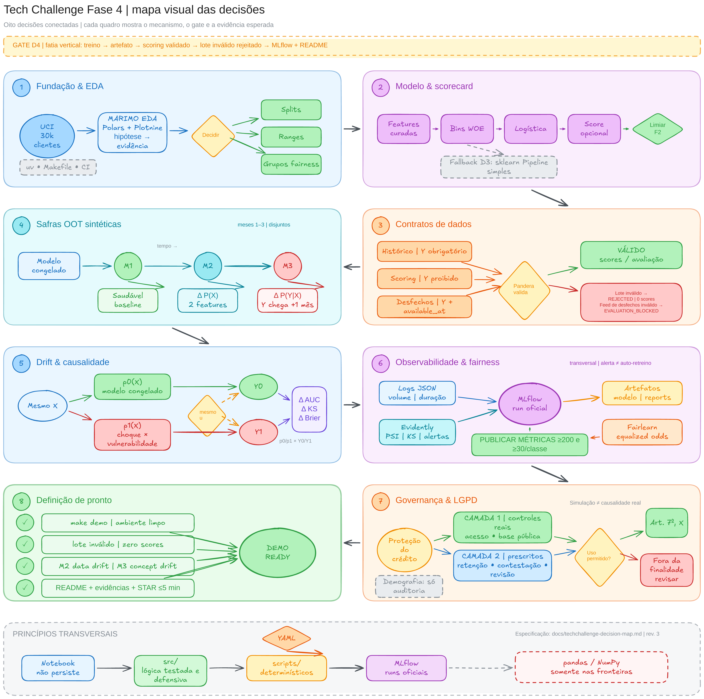

# Mapa visual das decisões

Este documento é a especificação narrativa do mapa visual do Tech Challenge. Ele explica o significado das relações desenhadas e define como manter o Markdown, o Excalidraw e o PNG sincronizados quando uma decisão mudar.

## Artefatos associados

- [Visual renderizado](techchallenge-decision-map.png)
- [Fonte editável](techchallenge-decision-map.excalidraw)
- [Arquitetura de runtime](architecture.md)
- [Plano e ordem de implementação](implementation-plan.md)
- [Rastreabilidade dos requisitos](requirements-traceability.md)

## Como ler o mapa

- Os números `1` a `8` e as setas grandes formam a ordem de leitura e de entrega, em serpentina.
- As setas dentro de cada card representam fluxo de dados, dependência lógica ou uma decisão.
- A ordem visual entre cards não substitui o fluxo de runtime. O contrato Pandera continua sendo aplicado antes do scoring, conforme [Arquitetura planejada](architecture.md#fluxo).
- O `GATE D4` é uma restrição transversal de prazo, não uma nona etapa; ele exige a fatia vertical até o dia 4, com rejeição Pandera, artefato, scoring validado, relatório MLflow e README inicial.
- A faixa `Princípios transversais` vale para todos os cards.

## Relações entre os cards

| Relação | Significado |
|---|---|
| `1 → 2` | A EDA fecha splits, ranges e grupos; essas decisões configuram o treino e a avaliação do modelo. |
| `2 → 3` | A fatia vertical do modelo fornece os campos, tipos e saídas que os contratos definitivos precisam proteger. No runtime, a validação ocorre antes do modelo. |
| `3 → 4` | As safras M1–M3 são materializadas como lotes mensais e passam pelo contrato; contrato inválido vai para quarentena e feed de desfechos inválido bloqueia a avaliação. |
| `4 → 5` | As safras materializam os cenários: M1 é baseline, M2 é data drift e M3 é concept drift; o contraste `p0/p1` é avaliado com `Y0/Y1`. |
| `5 → 6` | Métricas de drift, performance e contraste viram logs e relatórios; o run MLflow centraliza essas evidências. |
| `6 → 7` | Evidências técnicas e de fairness são interpretadas sob finalidade, base legal e controles de governança. |
| `7 → 8` | A entrega só fica pronta quando evidências, limites de interpretação e controles estão documentados. |

## 1. Fundação e EDA

**Relação desenhada:** `UCI → Marimo EDA → Decidir → {splits, ranges, grupos}`.

- O dataset UCI fornece a base observacional de 30 mil clientes.
- Marimo organiza cada investigação como hipótese, evidência e decisão.
- Polars e Plotnine são o stack principal de manipulação e visualização.
- A EDA deve fechar partições, ranges dos contratos e grupos de auditoria.
- `uv`, Makefile e CI formam a base executável que sustenta as etapas seguintes.

Fontes: [Plano de implementação](implementation-plan.md#dias-1-e-2-bootstrap-e-eda), [ADR 0009](adr/0009-make-and-uv-execution.md) e [ADR 0013](adr/0013-lightweight-ci.md).

## 2. Modelo e scorecard

**Relação desenhada:** `features curadas → bins WOE → logística → score → limiar F2`.

- Bins e WOE são ajustados somente no treino.
- A regressão logística produz a probabilidade de inadimplência.
- O score é uma representação opcional da mesma ordenação de risco.
- O limiar de `review_required` é escolhido por F2 na validação.
- Se OptBinning não estiver estável no dia 3, a rota desvia para uma `sklearn.pipeline.Pipeline` logística simples.

Fontes: [ADR 0005](adr/0005-woe-logistic-scorecard.md), [ADR 0014](adr/0014-curated-scorecard-features.md) e [Plano de implementação](implementation-plan.md#dias-3-a-5-fatia-vertical-e-scorecard).

## 3. Contratos de dados

**Relação desenhada:** três visões de entrada convergem em Pandera e se bifurcam em `VÁLIDO`, `REJECTED` ou `EVALUATION_BLOCKED`.

- Histórico exige alvo para treino e avaliação retrospectiva.
- Scoring proíbe alvo para impedir leakage.
- Desfechos exigem identificador, alvo e `available_at` para controlar maturação.
- Lote válido pode seguir para scoring ou avaliação.
- Contrato de entrada inválido → `REJECTED`: quarentena, zero scores e nenhuma chamada ao modelo.
- Feed de desfechos inválido → `OUTCOME_REJECTED`: scores preservados e avaliação `EVALUATION_BLOCKED`.
- `REJECTED`, `OUTCOME_REJECTED` e `EVALUATION_BLOCKED` são estados distintos e não devem ser colapsados.

Fontes: [ADR 0003](adr/0003-delayed-outcomes.md), [ADR 0006](adr/0006-pandera-data-contract.md), [ADR 0008](adr/0008-alert-and-quarantine-policy.md) e [ciclo de vida do lote](architecture.md#ciclo-de-vida-do-lote).

## 4. Safras OOT sintéticas

**Relação desenhada:** `modelo congelado → M1 → M2 → M3`.

- As três safras são disjuntas, materializadas como lotes mensais e só são criadas depois de congelar o modelo.
- As setas `M1 → M2 → M3` são temporais; não representam transformação de uma safra na seguinte.
- M1 é o baseline saudável.
- M2 altera `P(X)` em pelo menos duas features retidas e influentes.
- M3 é concept drift: altera `P(Y|X)` e só recebe o desfecho após a janela de um mês.
- A degradação de AUC, KS e Brier é consequência do mecanismo, não a definição do drift.

Fontes: [ADR 0004](adr/0004-three-stage-drift-scenario.md), [ADR 0003](adr/0003-delayed-outcomes.md) e [Plano de implementação](implementation-plan.md#dias-8-a-10-três-meses-e-data-drift).

## 5. Drift e causalidade

**Relação desenhada:** o mesmo perfil `X` alimenta `p0(X)` e `p1(X)`; o mesmo sorteio `u` produz o par `Y0` e `Y1`; as diferenças aparecem em AUC, KS e Brier.

- `p0(X)` é o `predict_proba` congelado do modelo monitorado; `p1(X)` combina o risco base com choque e vulnerabilidade.
- O mesmo sorteio `u` produz `Y0` e `Y1` para o mesmo perfil, isolando o contraste programado pelo simulador.
- As métricas comparam `p0/p1` contra `Y0/Y1`; as diferenças são consequência do mecanismo, não a definição do concept drift.
- O contraste é válido apenas dentro da simulação e não identifica um efeito econômico real.

Fontes: [Modelo causal](causal-model.md), [ADR 0010](adr/0010-causal-analysis-boundary.md) e [ADR 0011](adr/0011-drift-and-performance-detection.md).

## 6. Observabilidade e fairness

**Relação desenhada:** logs e Evidently convergem no run MLflow; Fairlearn passa pelo gate amostral e também registra no run; o run produz artefatos.

- Logs JSON registram estado, duração e volume sem linhas individuais.
- Evidently produz PSI, KS, relatórios e alertas de drift.
- Fairlearn calcula métricas desagregadas e `equalized_odds_difference`.
- O gate de publicação exige pelo menos 200 registros e 30 eventos e 30 não eventos por grupo.
- Somente depois do gate as métricas de grupo são registradas no run MLflow.
- MLflow centraliza configuração resolvida, métricas, modelo e relatórios; é sorvedouro de evidências, não fonte de fairness nem do gate.
- Alerta abre investigação; não existe auto-retreino nem promoção automática.

Fontes: [ADR 0007](adr/0007-local-observability-with-mlflow.md), [ADR 0011](adr/0011-drift-and-performance-detection.md), [Plano de fairness](fairness-plan.md) e [ADR 0002](adr/0002-scoring-and-fairness-data-views.md).

## 7. Governança e LGPD

**Relação desenhada:** a finalidade de proteção do crédito passa por duas camadas de controle e por uma decisão de uso permitido.

- A base legal assumida é proteção do crédito, art. 7º, X da LGPD.
- A camada 1 mostra controles realmente implementados no projeto acadêmico.
- A camada 2 separa controles prescritos para uma produção hipotética.
- A decisão `Uso permitido?` é jurídica: verifica finalidade e base legal, não afirma identificação causal.
- Atributos demográficos existem somente na visão restrita de auditoria e não entram no score.
- Contestação, revisão, retenção e direitos do titular pertencem à camada prescrita.
- O cenário sintético não autoriza alegações de causalidade econômica real; esse é um limite epistêmico separado da permissão de uso.

Fontes: [Plano de governança](governance-plan.md), [ADR 0012](adr/0012-two-layer-lgpd-plan.md) e [ADR 0002](adr/0002-scoring-and-fairness-data-views.md).

## 8. Definição de pronto

**Relação desenhada:** quatro evidências convergem em `DEMO READY`.

- `make demo` executa em ambiente limpo.
- Um lote com contrato inválido produz zero scores; um feed de desfechos inválido bloqueia a avaliação.
- M2 demonstra data drift (`P(X)`) e M3 demonstra concept drift (`P(Y|X)`) com a degradação esperada.
- README, evidências e apresentação STAR de até cinco minutos estão concluídos.

Fontes: [Plano de implementação](implementation-plan.md#dias-13-e-14-demo-e-documentação), [Rastreabilidade](requirements-traceability.md) e [Roteiro STAR](video-star-plan.md).

## Princípios transversais

O pipeline inferior significa:

1. Notebook explora e documenta, mas não persiste artefatos oficiais.
2. Lógica durável é promovida para `src/`, com testes e programação defensiva.
3. Scripts determinísticos carregam YAML validado, importam `src/` e persistem resultados.
4. MLflow registra os runs oficiais.
5. pandas e NumPy aparecem apenas nas fronteiras de bibliotecas incompatíveis; o fluxo principal é Polars-first.

## Invariantes que o desenho deve preservar

- Contrato de entrada inválido nunca chama o modelo e nunca gera scores.
- `REJECTED` (contrato inválido), `OUTCOME_REJECTED` (feed de desfechos inválido) e `EVALUATION_BLOCKED` são estados distintos.
- O modelo é congelado antes da geração das safras OOT; cada safra é materializada como um lote mensal.
- M2 altera `P(X)`; M3 altera `P(Y|X)`.
- `Y0` e `Y1` usam o mesmo sorteio `u` para o mesmo perfil.
- Drift gera alerta e investigação, não auto-retreino.
- MLflow recebe evidências; não origina métricas de fairness nem decide publicação.
- Dados demográficos não entram no score e ficam restritos à auditoria.
- A simulação não sustenta alegações causais sobre a economia real; permissão legal e limite causal são dimensões distintas.
- Notebooks não persistem artefatos oficiais.

## Impacto de mudanças

| Mudança lógica | Cards a revisar | Fontes principais |
|---|---|---|
| Dataset, splits, ranges ou grupos | 1, 3 e 4 | `domain-model.md`, `implementation-plan.md` |
| Features, modelo, score ou limiar | 2, 5 e 8 | ADRs 0005 e 0014 |
| Schemas, quarentena ou estados do lote | 3 e 8 | ADRs 0003, 0006 e 0008 |
| Regras das safras ou atraso do alvo | 4, 5 e 8 | ADRs 0003 e 0004 |
| Mecanismo causal, métricas de drift ou limite causal | 5, 6, 7 e 8 | `causal-model.md`, ADRs 0010 e 0011 |
| Observabilidade ou ferramentas de relatório | 6 e faixa transversal | ADR 0007, `architecture.md` |
| Fairness ou regra de publicação | 1, 6, 7 e 8 | `fairness-plan.md`, ADR 0002 |
| LGPD, finalidade ou controles | 7 e 8 | `governance-plan.md`, ADR 0012 |
| Workflow, scripts ou persistência | 1, `GATE D4` e faixa transversal | `implementation-plan.md`, ADRs 0009 e 0013 |

## Revisão

- Revisão 3 (2026-10-23): separação de `REJECTED`, `OUTCOME_REJECTED` e `EVALUATION_BLOCKED`; MLflow como sorvedouro de evidências; cadeia `Fairlearn → gate → MLflow`; permissão legal separada do limite causal; safras como lotes mensais e M3 como concept drift.

## Procedimento de sincronização

Quando a lógica mudar:

1. Atualizar primeiro o documento detalhado ou ADR que contém a decisão canônica.
2. Atualizar neste arquivo as relações, invariantes e a tabela de impacto afetadas.
3. Incrementar `diagram_version` e atualizar `last_synced` no frontmatter.
4. Editar `techchallenge-decision-map.excalidraw` nos cards indicados pela tabela de impacto.
5. Exportar `techchallenge-decision-map.excalidraw` e reexportar `techchallenge-decision-map.png`; verificar truncamentos, sobreposições e direção das setas.
6. Conferir se todos os invariantes continuam visíveis e se a rastreabilidade precisa ser atualizada.

Em edição via canvas, exporte o `.excalidraw` com frequência; se o servidor reiniciar, reimporte o arquivo como fonte de recuperação.

A sincronização é intencionalmente manual: o Markdown explica a semântica e o Excalidraw preserva a comunicação visual. O nome-base compartilhado e este checklist permitem que uma pessoa ou agente identifique rapidamente os artefatos que devem mudar juntos.
